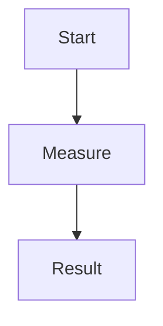

# FR-021: Device check flow

## Description

This diagram shows a measurement moving through a check.

## Acceptance Criteria

| ID | Criteria | Verification |
| --- | --- | --- |
| FR-021-AC-1 | The exported document contains the diagram as an image. | Demonstration |

## Dependencies

No dependencies are declared for this example.
