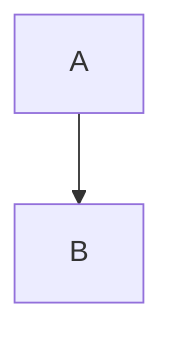

# [FR-001] Ember Overview

## Description

The system SHALL do a real, concrete, normative thing on request.

- first fixture item
- second fixture item

## Specification

The implementation SHALL satisfy the described behavior under all inputs.

```rust
fn quill_fixture() {}
```



## Acceptance Criteria

| ID | Criteria |
|----|----------|
| FR-001-AC-1 | It does the thing |
| FR-001-AC-2 | It does the other thing |
